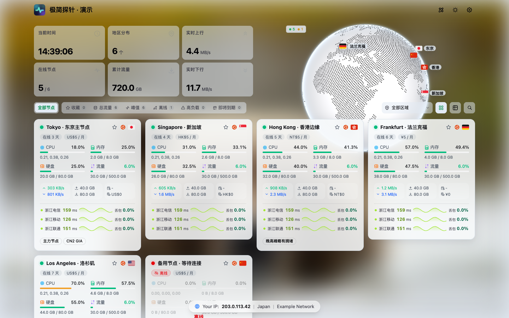

# Glassmorphism Transparent for 极简探针



本项目是基于 [Gongsc/Theme-Glassmorphism](https://github.com/Gongsc/Theme-Glassmorphism) 1.4.5 改编的**透明模式版本**。上游项目将 [sanrokamlan-prog/komari-theme-Glassmorphism](https://github.com/sanrokamlan-prog/komari-theme-Glassmorphism)（v3.3.7）主题移植至 [极简探针 Monitor](https://github.com/monitor-probe/monitor)，数据改由 Monitor 的 REST 与 WebSocket 接口提供，无需部署 Komari 服务器。透明模式的交互与配色参考 [Tokinx/komari-theme-emerald](https://github.com/Tokinx/komari-theme-emerald) 的 Glass 版本。

当前版本为 1.5.0。本项目沿用原项目的 MIT 许可，并保留原作者署名。

## 相对上游主题的改动

改编自 Gongsc/Theme-Glassmorphism 1.4.5，改动集中在透明模式：

- **新增第四种主题模式 `transparent`**：顶部主题按钮按 自动 → 浅色 → 深色 → 透明 循环；后台「默认主题模式」也可选透明。
- **卡片与顶栏改为半透明烟熏玻璃**：卡片底色由上游的常规玻璃改为可调透明度的深色玻璃（默认 15%），叠加背景模糊与描边，文字统一为白色并带投影。
- **透明模式默认隐藏地球**：让背景图成为视觉主体，可在设置中重新打开。
- **独立的背景配置**：透明模式可使用单独的背景地址（留空复用亮色背景），并拥有独立的模糊与遮罩参数，互不影响浅色 / 深色。
- **弹窗与表单保持可读**：设置面板、对话框、数据提示、访客信息条在透明模式下改用高不透明度深色底，避免「透明到看不清」。
- **兼容兜底**：Firefox 与旧版 WebKit 无法高效合成多层 `backdrop-filter` 时，自动改用更实的底色。
- **主题标识独立**：`short` 由 `glassmorphism` 改为 `glassmorphism-transparent`，配置接口与安装目录随之独立，可与原版同时安装。
- **浅色 / 深色行为不变**：仅将模式解析重构为「浅色 / 深色 / 透明」三态，原有配色预设、地球、节点卡片等不受影响。

## 透明模式的优势

- **背景图成为主视觉**：卡片与顶栏只保留一层薄烟熏玻璃，页面大部分区域直接透出背景图，适合以壁纸、风景照或品牌图作为站点门面。
- **透明但看得清**：没有采用白色蒙版（白底配深字在暗色照片上会糊），而是深色玻璃 + 白字 + 投影，文字对比度不依赖背景明暗。
- **参数化适配不同背景**：卡片不透明度、背景模糊、背景遮罩均可调。亮色照片调高遮罩，暗色照片调低，无需改代码。
- **不打断原有习惯**：浅色 / 深色模式、配色预设、地球样式、节点卡片等完全保持原样，透明模式只是第四个可选状态。
- **访客可自行选择**：顶部按钮四态循环，访客切到透明模式只影响自己的浏览器，不会改动站点默认值；站长也可以在后台把透明设为默认。
- **仍是纯静态主题包**：不引入额外依赖或外部服务，构建产物与安装方式与原版一致。

## 主要功能

- **玻璃拟态外观**：提供动态渐变背景，以及翡翠、柔和、高对比、午夜和自定义五种配色；支持浅色、深色及按北京时间自动切换。背景可选用图片、视频或 Bing 每日壁纸。
- **透明模式**：顶部主题按钮在自动、浅色、深色之外增加透明模式，也可在后台设为默认。透明模式下卡片、顶部栏改为半透明烟熏玻璃，地球默认不显示，背景图成为页面主视觉；卡片不透明度、背景模糊、遮罩与文字阴影均可在设置中调整。
- **地球与地图**：提供贴图地球、Cobe 点阵地球、平铺世界地图和点阵平铺地图四种样式，标注节点所在国家，支持自动旋转或隐藏。启用「地球显示城市」后，将根据节点名称识别城市并标注城市名称。
- **首页概览**：概览卡片提供多种预设方案，并支持自定义顺序；另提供公告（支持 Markdown）、快捷筛选（收藏、离线、高负载、即将到期等）、区域筛选、搜索及节点收藏功能。
- **节点分组**：支持 Monitor 原生分组，节点按后台设定的顺序排列，并提供「未分组」入口。切换分组后，概览、地球及工具面板仅统计当前分组。
- **节点卡片**：提供 mini、compact、comfortable、large 四种卡片尺寸及列表视图，离线节点排列于末尾；离线卡片以淡化样式显示，并标注「离线」。
- **多线路延迟**：普通卡片默认显示至多 3 条探测线路，左侧为最新延迟及历史色条，右侧为最近 1 小时的丢包率及历史色条；点击线路可查看延迟详情。「卡片延迟样式」可切换为延迟曲线，悬停或点按曲线可查看对应时段的延迟与丢包率。
- **节点详情**：包含资源负载图、延迟图、费用与剩余价值计算、节点对比及数据快照导出。
- **站点图标**：可在设置中指定页面左上角、浏览器标签页和 iOS 主屏幕使用的图标，支持填写 http(s) 图片地址、站内路径，或在主题设置面板中直接上传图片；上传的图片将缩放为 180×180 并保存在站点配置中，无需另行托管。由于页面外壳为静态文件，首次加载时浏览器标签页会短暂显示内置图标。
- **站点设置**：管理员登录后可在页面中直接调整设置并实时预览，保存至 Hub 后对全部访客生效。设置亦可在后台主题卡片中修改，两处共用同一份配置，并支持导出、导入及恢复默认值。

## 1.5.0 更新内容

- 基于上游 1.4.5 改编为透明模式版本，主题标识改为 `glassmorphism-transparent`。
- 新增透明模式：卡片与顶部栏改为半透明烟熏玻璃，背景图成为主视觉，浅色/深色模式保持原样。
- 顶部主题按钮循环顺序变为 自动 → 浅色 → 深色 → 透明，后台「默认主题模式」也可选择透明。
- 新增透明模式设置：独立背景地址（留空复用亮色背景）、背景模糊、背景遮罩、卡片不透明度、隐藏地球、文字阴影。

## 1.4.5 更新内容

- 适配极简探针 1.4.1：节点详情的内存图恢复 Swap 曲线，并新增「网络连接」（TCP/UDP）与「进程」两张历史图表。较早版本的 Hub 不提供这些数据，相应曲线与图表不显示。
- 「默认」详情负载图方案加入连接与进程两项；使用自定义 keys 的站点可自行添加 `connections`、`process`。
- 修复浏览器禁用站点数据（Cookie 与网站数据）时页面白屏的问题。此时主题照常显示，浅色/深色、视图模式、收藏等偏好仅在当前页面有效。

## 1.4.4 更新内容

- 修复 1.4.3 引入的问题：在浏览器中切到其他网页、过一段时间再切回时，节点卡片偶尔整排显示「延迟数据暂不可用」并持续约一分钟。切回时不再重复刷新、中止刚发出的请求。
- 延迟卡片读取失败后 5 秒自动重试，连续失败时再恢复为每分钟一次。

## 1.4.3 更新内容

- 添加到 iOS 主屏幕后从后台切回时，不再闪现「连接错误」：单次请求失败只计数并在 1–2 秒内快速重试，连续 3 次失败才提示；任意一次数据更新成功即恢复正常。
- 页面恢复时若未收到可见性变化事件，会在页面重新显示或获得焦点、且数据已明显过期时立即刷新并重新连接。

## 1.4.2 更新内容

- 手机等设备将页面切到后台再切回时，不再误报「连接错误」：页面隐藏时暂停轮询与推送并中止在途请求，回到前台后立即刷新数据并重新连接。

## 1.4.1 更新内容

- 管理员登录后，节点卡片在公开备注之后一并显示私有备注，重复的项只显示一次。私有备注仅在登录后由 Hub 下发，访客无法看到。
- 平铺地图与点阵平铺地图的右侧图例改为与统计卡片一致的样式：顶部显示在线节点数、在线率与进度条，下方逐行列出地区及其节点数；部分节点离线的地区以「在线数/总数」标出。地区较多时改为两列，放不下时可在图例内滚动。地图左上角的在线/离线标签已移除。
- 「首页探测线路名称或 ID」默认留空，自动显示可用线路，不再预填浙江电信、浙江移动、浙江联通。

## 1.4.0 更新内容

- 适配极简探针 1.3.2 的历史保留天数：负载图与延迟图的时间范围按 Hub 设定的保留天数（`history_days`，1–365 天）生成，访客与管理员可查看的范围相同；保留期比某一档多不到四分之一时不再并列显示两档。旧版 Hub 仍按访客 7 天、管理员 90 天处理。
- 超过 7 天的范围由 Hub 按小时汇总，负载图按 Hub 返回的点距（`step`）绘制，长范围不再出现重复的阶梯点。
- CPU 图以虚线绘制区间内的最高占用（`cpu_max`），健康概览的 CPU 峰值同样依据该值计算。
- 节点卡片显示站长在后台填写的公开备注（`public_remark`），访客与管理员看到的内容一致。
- 价格按货币代码格式化，如 `US$5`、`HK$5.50`、`NT$12`；Hub 1.3.1 之前保存的非标准货币值按原样显示。数据快照中的其他币种不再被标为人民币。

## 1.3.1 更新内容

- 适配极简探针 1.3.1 的任意付款周期：以 `<n>m` 形式存储的周期（如 18 个月、5 年）将正确计算价格与剩余价值，并显示为「18 个月」「10 年」等。
- 适配任意三字母货币代码：费用统计按汇率接口提供的对应汇率折算；无汇率的币种不计入合计，不再按人民币计算。
- 延迟线路按后台延迟监控页设定的顺序显示。
- 新增「站点图标」设置，可指定页面左上角、浏览器标签页和 iOS 主屏幕使用的图标。
- 移除背景地址的 `local:` 前缀，该前缀指向 Monitor 不提供的路径；背景地址按填写原样使用。

## 1.3.0 更新内容

- 依据 Monitor 后端源码核对各项数据来源，移除 Hub 未提供数据的功能，包括 GPU、温度、自定义标签、城市与 ASN 信息、拓扑工具，以及节点详情中无有效数据的网络连接曲线、进程曲线和负载、Swap 历史曲线。相关设置项与预设方案一并移除，已保存的失效取值将自动恢复为默认值。
- 节点详情的负载图精简为 CPU、内存、磁盘和网络四项，并采用两列布局。
- 管理员登录后，节点详情页的「网络信息」区域将显示节点的 IPv4 与 IPv6 地址。地址取自 Hub 为管理面板选定的地址，位于 NAT 之后的节点显示其公网出口地址；访客无法查看。
- 主题不再将节点 IP 发送至第三方查询服务，服务商仅依据节点名称与备注识别。
- Hub 提供各时间区间内的峰值速率时，网络图将以虚线绘制上下行峰值，「近一天峰值」亦改为依据峰值计算。
- 流量配额直接采用 Hub 按计费方式计算的本周期用量 `month_used`，与后台及流量告警保持一致。

## 安装

在极简探针后台依次进入「主题」→「上传主题包」，选择本项目 `npm run package` 生成的 `release/theme.tar.gz`（同时会输出带版本号的 `monitor-theme-glassmorphism-transparent-1.5.0.tar.gz`）并启用。

主题标识为 `glassmorphism-transparent`，与上游的 `glassmorphism` 不同，因此可与原版玻璃拟态主题同时安装、分别启用，两者的站点配置互不影响。

> 主题卡片上的「从 GitHub 更新」指向 `theme.json` 中的上游仓库地址，更新后会覆盖本项目的透明模式改动。更新本主题请重新上传本项目生成的 `theme.tar.gz`。

## 与 Komari 原版的差异

- **节点地址与位置**：Monitor 仅向已登录用户返回节点 IP。登录后，详情页显示 IPv4 与 IPv6 地址，搜索支持按 IP 匹配，数据导出包含地址信息；访客无法获取上述信息。地球按国家中心坐标定位节点；启用「地球显示城市」后，城市依据节点名称推断，以上位置均不代表机房的实际地理位置。服务商仅依据节点名称与备注识别（访客为公开备注，登录后另含私有备注），主题不会将节点 IP 发送至任何第三方。
- **已移除的功能**：原版中的 GPU、温度、自定义标签、城市与 ASN 信息、拓扑工具及审计日志依赖 Monitor 未提供的数据，均已移除。
- **历史图表**：历史数据包含 CPU、内存、磁盘、上下行速率及 Ping；极简探针 1.4.1 起另含 Swap、TCP/UDP 连接数和进程数，详情页据此绘制 Swap 曲线及「网络连接」「进程」两张图表，较早版本的 Hub 不提供这些数据，相应曲线与图表不显示。负载仅提供实时值，不绘制历史曲线。Hub 返回各时间区间内的峰值速率（`net_rx_max` / `net_tx_max`）时，网络图以虚线绘制峰值，详情页的「近一天峰值」亦据此计算；较早版本的 Hub 不提供该数据，此时仅显示平均速率。
- **流量统计**：流量配额采用 Hub 依据节点计费方式（上行、下行、取较大值或求和）计算的本周期用量 `month_used`，与后台及流量告警保持一致；较早版本的 Hub 不提供该字段，此时主题按相同规则，依据本月上传量与下载量计算。累计流量为节点接入以来的总量。
- **外部服务**：访客信息条默认启用，该功能会请求第三方 IP 查询服务，可在设置中关闭；汇率与图标的加载同样依赖外部服务。
- **后台管理**：后台管理功能由极简探针的 `/admin/` 页面提供，主题包不包含 Komari 后台。

## 开发

开发环境需要 Node.js 24 或更高版本及 npm。常用命令如下：

```sh
npm ci
npm run dev       # 启动开发服务器
npm run build     # 执行类型检查并构建
npm run lint      # 代码检查
npm test          # 运行测试
npm run package   # 生成 release/theme.tar.gz
```

开发服务器默认将 `/api` 请求代理至 `127.0.0.1:9911`。如需连接已开启公开状态页的 Hub，可设置环境变量 `MONITOR_HUB=https://hub.example.com`。若无可用的 Hub，可在另一终端运行 `python3 scripts/demo-server.py` 以提供演示数据；设置 `DEMO_AUTHED=1` 后，演示服务将模拟管理员登录状态，并为节点提供文档保留网段中的示例地址，用于检查登录后的界面。

`preview.png` 为使用演示数据截取的 1440×900 首页截图，其中访客 IP 为示例地址。重新截图时，请勿记录真实的访客 IP。

## 发布

发布新版本时，须将 `theme.json`、`package.json`、`package-lock.json` 和 `vite.config.ts` 中的版本号统一修改为新版本号，然后推送格式为 `x.y.z` 的 tag（例如 `1.3.0`）。GitHub Actions 将自动完成构建，并创建附带 `theme.tar.gz` 的 Release。
